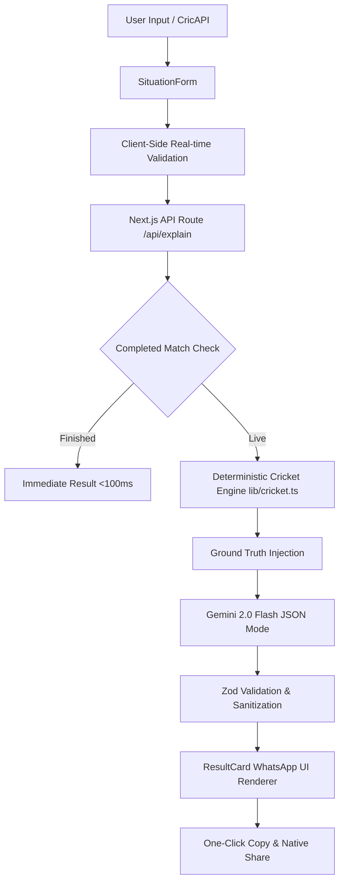

# MatchPulse Architecture 🏏

## System Overview
MatchPulse is a single-page AI-native web application designed to solve the live cricket fan dilemma: **"Ab kya hoga?"**. During high-tension match situations (e.g. 42 needed off 27 balls), casual fans don't want spreadsheets of stats; they want conversational answers explaining tactical expectations in natural Hinglish or English.



## Data Flow Pipeline
1. **User Input / Preset**: User specifies batting/bowling teams, current score, wickets, overs completed, and target (or toggles defending).
2. **Real-time Client Validation**: Instant feedback verifies decimal balls (0-5), wickets (0-10), and target constraints before submission.
3. **Route Handler (`/api/explain`)**:
   - Runtime Zod validation against `MatchSituationSchema`.
   - Fast-path evaluation: Completed chases, all-out innings, or exhausted overs short-circuit immediately without calling the AI.
   - Deterministic calculations: `calculateCricketStats` computes exact balls remaining, RRR, current RR, wickets in hand, and resource percentage.
4. **AI Reasoning Layer (`lib/gemini.ts`)**:
   - Injects exact numbers as ground truth with few-shot examples.
   - Enforces strict JSON schema via Gemini structured outputs.
   - Retries once on invalid JSON syntax with explicit error handling.
5. **Display & Sharing**:
   - `ResultCard` renders WhatsApp-style cards with win probability progress bars and tactical action plans.
   - One-click copy formats messages with proper line breaks for WhatsApp chats.

## Component Hierarchy
```
RootLayout
└── Home (app/page.tsx)
    ├── Header
    │   ├── App Title & Logo
    │   └── LanguageToggle (Hinglish | English)
    ├── Tabs ("Live Situation" | "Playoff What-If")
    ├── ErrorBoundary
    │   ├── SituationForm
    │   │   ├── Presets (42 off 27, 13 off 6, Defend 195)
    │   │   ├── Live Score Fetcher
    │   │   └── Real-time Inline Errors
    │   ├── LoadingSkeleton (3 Shimmer Lines)
    │   ├── ResultCard (WhatsApp Bubble)
    │   │   ├── Situation Summary
    │   │   ├── Key Number Pill
    │   │   ├── Batting Actions (3 Bullets)
    │   │   ├── Bowling Plan (2 Bullets)
    │   │   ├── Win Probability Gauge
    │   │   ├── Watch-For Tactics
    │   │   └── Copy & Share Buttons
    │   └── WhatIfPanel (Dynamic Import)
    │       ├── Standings Textarea
    │       └── Scenario Analysis Engine
    └── Footer
```

## Security & Secrets
- `GEMINI_API_KEY` and `CRICAPI_KEY` are only consumed server-side in API route handlers.
- Neither key is ever exposed to the client bundle.
- `.env.local` is ignored in `.gitignore`.
